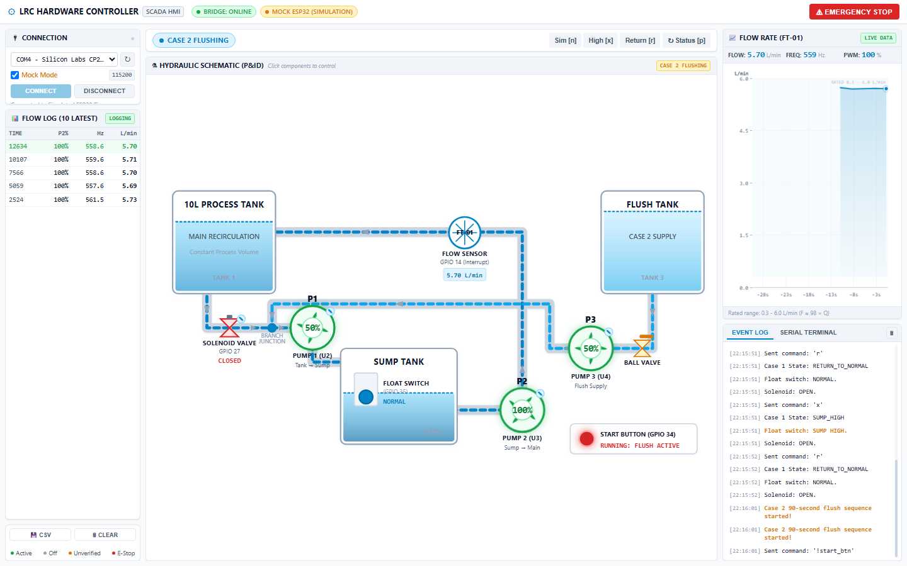
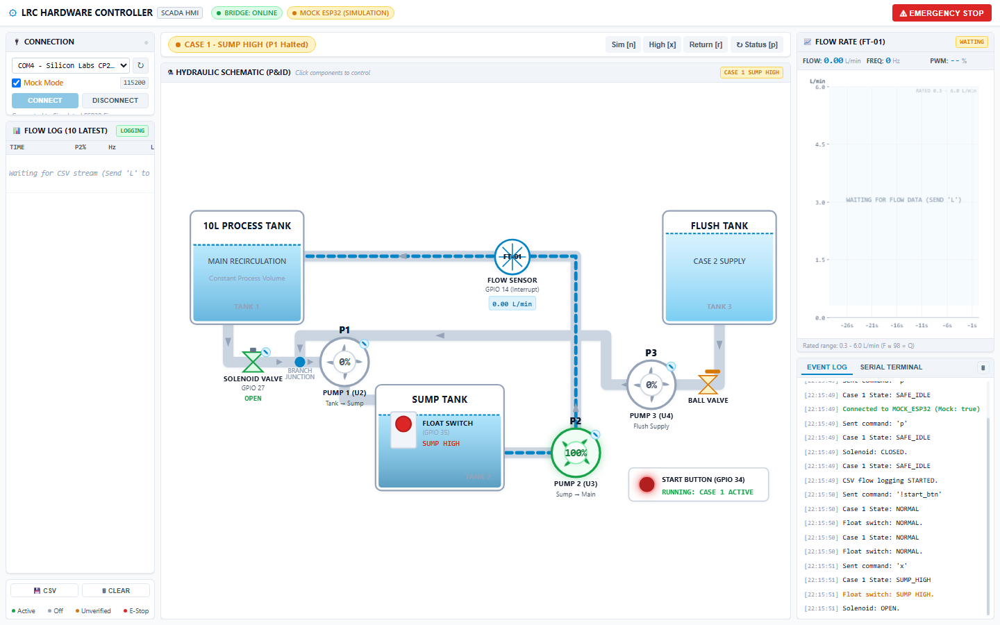
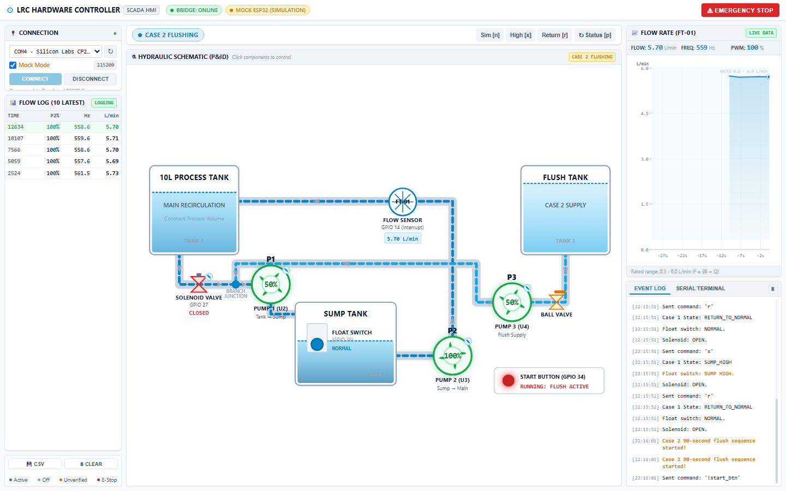

# Lam Research Challenge 3.0 — Automated Liquid-Handling System

An automated liquid-handling and recirculation control rig built for Stage 2 of the Lam Research Challenge 3.0. This project combines ESP32 firmware with a light-industrial SCADA browser dashboard to run fluid recirculation, handle sump overflows, and execute a timed clean-in-place flush sequence safely.

**GitHub Repository:** [https://github.com/VikasBhaskar-gif/LRC-HardwareHustle](https://github.com/VikasBhaskar-gif/LRC-HardwareHustle)

---

## Project Overview

In semiconductor manufacturing, chemical delivery and wafer cleaning lines rely on precise fluid recirculation, overflow containment, and thorough line flushing. 

Our team designed and built this benchtop automated liquid-handling system to simulate those industrial processes. The controller runs continuous fluid circulation, detects high liquid levels in a sump tank to prevent spills, waits for the system to stabilize, and automatically runs a synchronized 90-second flush routine before shutting down safely into a latched state.

---

## Screenshots

### Main SCADA Dashboard & P&ID Schematic


### Sump High Alarm (Overflow Prevention)


### Case 2 90-Second Flush Sequence


---

## How It Works

The system connects three tanks using PVC tubing, three DC pumps, an isolation valve, and two feedback sensors.

```
[10L Main Process Tank] ---> [Solenoid Valve] ---> [Tee Junction] ---> [Pump 1] ---> [Sump Tank]
                                                          ^                              |
[Flush Water Tank] --------> [Pump 3] --------------------+                              |
                                                                                         v
[10L Main Process Tank] <--- [Flow Sensor FT-01] <--------------------------------- [Pump 2]
```

### 1. Safe Standby (`SAFE_IDLE`)
When the ESP32 boots up or connects to power, all pumps stay at 0% and the solenoid valve stays closed. Turning on the software system switch never starts the motors automatically—it requires a physical button press on GPIO 34 (or an explicit start command over serial) to begin.

### 2. Normal Recirculation (Case 1)
- **Solenoid Valve**: Opens (active HIGH) to let liquid gravity-feed from the 10L Main Tank.
- **Pump 1 (Driver U2)**: Runs at 50% speed to feed fluid down into the Sump Tank.
- **Pump 2 (Driver U3)**: Runs at 100% speed to pump liquid out of the sump through the YF-S401 flow sensor and back up into the main tank.
- **Pump 3 (Driver U4)**: Remains OFF (0%).
- Fluid recirculates in a continuous closed loop, and live flow rate is measured in real time.

### 3. Sump High Handling
- If liquid in the sump rises high enough to close the float switch (GPIO 35 pulled LOW):
  - **Pump 1 stops immediately (0%)** so no more fluid enters the sump.
  - **Pump 2 stays at 100%** to rapidly drain the sump back into the main tank.
  - Solenoid valve stays open.

### 4. 10-Second Stabilization Delay
- Once Pump 2 lowers the sump level and the float switch clears (GPIO 35 goes HIGH), Pump 1 resumes at 50% and a 10-second timer starts.
- If fluid sloshing trips the float switch again during these 10 seconds, the timer cancels and the system immediately goes back to draining the sump.
- If the 10 seconds complete cleanly without any float triggers, the controller automatically triggers the Case 2 flush.

### 5. Automatic Flush Sequence (Case 2)
- **Solenoid Valve closes immediately** to isolate the 10L main process tank and protect it from flush water.
- **Pump 1 (50%)**, **Pump 2 (100%)**, and **Pump 3 (50%)** all run together for exactly 90 seconds. Pump 3 pulls clean water from the flush tank, Pump 1 passes it through the sump, and Pump 2 scavenges it through the flow line.
- A non-blocking 90-second countdown runs on both the firmware and dashboard.

### 6. Final Safe Shutdown
- When the 90-second flush ends, all three pumps shut off (0% duty, driver enables pulled LOW), the solenoid valve stays closed, and the system enters a latched shutdown state.
- In this latched state, button presses and float switch triggers are locked out until an operator resets or toggles the system switch.
- *(Note: Flush termination is strictly time-based. The flush tank does not have a level sensor, so the system relies on the 90-second timer rather than detecting an empty tank).*

---

## Hardware Used

- **Microcontroller**: ESP32 NodeMCU (30-pin Dev Module)
- **Motor Drivers**: 3x BTS7960 (IBT-2) 43A High-Power H-Bridge drivers (U2 for Pump 1, U3 for Pump 2, U4 for Pump 3)
- **Pumps**: 3x 12V DC diaphragm pumps
- **Flow Sensor**: YF-S401 Hall-effect turbine sensor on GPIO 14 (Interrupt-driven, calibrated at 98 Hz per L/min)
- **Float Switch**: Vertical magnetic float switch on GPIO 35 (active LOW with external 10 kΩ PCB pull-up)
- **Solenoid Valve**: 12V DC normally-closed isolation valve on GPIO 27 (driven via AOD4184A MOSFET / relay circuit)
- **Start Button**: Momentary push button wired to PCB connector labeled `ON/OFF SWITCH` (GPIO 34, input-only GPI with external 10 kΩ pull-up R10 and 100 nF debounce capacitor C9)
- **Power Supply**: Mean Well LRS-350-12 (12V DC, 29A, 350W) powering the pumps and solenoid

### Pin Assignment Summary

| Component | Signal | ESP32 Pin | Logic Level |
| :--- | :--- | :---: | :--- |
| **Pump 1 (U2)** | L_PWM / R_PWM / L_EN / R_EN | GPIO 32, 33, 13, 26 | 5 kHz PWM (Ch 0/1), 8-bit |
| **Pump 2 (U3)** | L_PWM / R_PWM / L_EN / R_EN | GPIO 18, 19, 16, 17 | 5 kHz PWM (Ch 2/3), 8-bit |
| **Pump 3 (U4)** | L_PWM / R_PWM / L_EN / R_EN | GPIO 23, 25, 21, 22 | 5 kHz PWM (Ch 4/5), 8-bit |
| **Solenoid Valve** | Control signal | GPIO 27 | Active HIGH (HIGH = Open, LOW = Closed) |
| **Float Switch** | Level detection | GPIO 35 | Active LOW (LOW = Sump High, HIGH = Normal) |
| **Flow Sensor** | Pulse output | GPIO 14 | Hardware interrupt (RISING edge, $Q = F / 98.0$) |
| **Start Button** | Trigger auto sequence | GPIO 34 | Active LOW momentary (Input-only, external pull-up) |

---

## Software Used

- **Firmware**: Written in C++ using the Arduino framework on PlatformIO (`platform = espressif32`, `board = esp32dev`). Built around non-blocking hardware PWM, software debouncing, and an interrupt-driven flow counter.
- **Python Serial Bridge**: `ui/bridge.py` built with FastAPI, Uvicorn, WebSockets, and PySerial. It handles two-way communication between USB serial (115200 baud) and the browser, and includes an in-memory mock firmware emulator for testing without physical hardware.
- **Web SCADA Dashboard**: Built with vanilla HTML5, CSS3, and modern JavaScript. Uses an SVG hydraulic P&ID diagram with live animated pipes, a 60-second rolling Canvas flow chart, and interactive component popovers.

---

## Key Features

- **Automated State Machine**: Handles the full sequence from start button press $\rightarrow$ normal flow $\rightarrow$ sump high recovery $\rightarrow$ 10-second delay $\rightarrow$ 90-second flush $\rightarrow$ safe latched shutdown.
- **Hardware-Level Safety Hierarchy**:
  - Universal Emergency Stop (Spacebar, serial `s`, or dashboard button) instantly halts all pumps and closes the valve.
  - Software system switch acts as a master disable.
  - Safe idle on boot prevents any motor from turning on unexpected power cycles.
  - Manual start of Pump 3 is locked out because the flush line ball valve has no position sensor.
- **Interactive P&ID Schematic**: Click directly on pumps, the solenoid valve, or sensors on the diagram to inspect values, set duty cycles (25%, 50%, 75%, 100%), or toggle valves.
- **Live Telemetry & CSV Export**: Displays a 10-row rolling flow table, real-time flow rate / pulse frequency, and one-click session CSV downloads.
- **Hardware & Mock Modes**: Test directly with an ESP32 over USB serial or switch to Mock Mode to simulate the entire system inside the browser.

---

## Quick Start

### 1. Build & Upload Firmware
Using PlatformIO in VS Code (or from the terminal):
```bash
# Compile and upload firmware
platformio run --target upload

# Open serial monitor (115200 baud)
platformio device monitor -b 115200
```

### 2. Run the SCADA Dashboard
Install Python requirements and launch the bridge:
```bash
cd ui
pip install -r requirements.txt
python bridge.py
```

Open your browser and navigate to:
**[http://127.0.0.1:8080](http://127.0.0.1:8080)**

Select your ESP32's COM port and click **CONNECT** (or check **Mock Mode** to test without hardware).

---

## Project Documentation

- Full source code logic printout: [`Liquid_Handling_Control_Logic.pdf`](Liquid_Handling_Control_Logic.pdf)
- GitHub Repository: [https://github.com/VikasBhaskar-gif/LRC-HardwareHustle](https://github.com/VikasBhaskar-gif/LRC-HardwareHustle)
